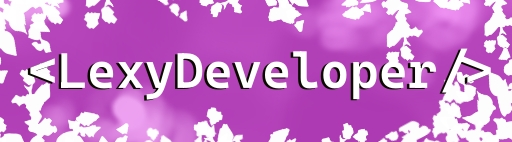

<h1 align="center">¡Hola! Soy LexyDeveloper</h1>

  

Soy un **desarrollador web de nivel medio** apasionado por la creación de la automatizacion de tareas, además de aplicaciones modernas, funcionales y con buenas prácticas de código. Me gusta aprender nuevas tecnologías y aplicar mis conocimientos en proyectos que aporten valor.   

---

## Sobre mí  

- Me considero una persona **curiosa** y en constante aprendizaje.  
- Enfocado en escribir código **limpio y mantenible**.  
- Abierto a colaborar en proyectos interesantes y de impacto.

---

## Tecnologías y Herramientas  

- **Frontend:** HTML5, CSS3, JavaScript (ES6+), React  
- **Backend:** Node.js, PHP  
- **Bases de datos:** MySQL  
- **Otras herramientas:** Git, GitHub, VS Code, VS Studio 

---

## Algunos proyectos  

- [LexyCrochet.web](https://lexy-crochet.web.app/) – Negocio personal de crochet

---

## Contacto  

- **Correo:** alexgrg.123.123@gmail.com
- [alexis.g.r.g](https://www.instagram.com/alexis.g.r.g/) – Cuenta personal de instagram para contacto 
- [LinkedIn](#)  

---
